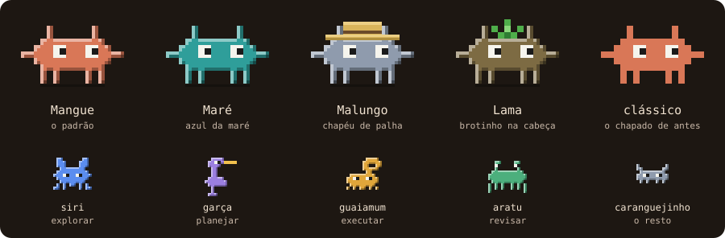
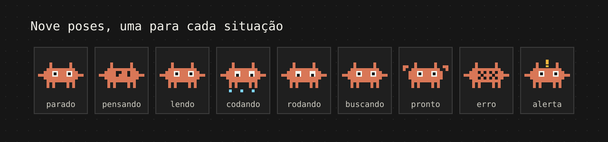
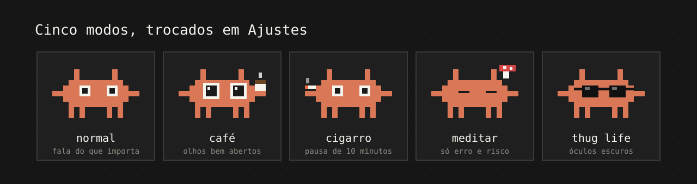

<p align="center">
  
</p>

# Claudin

Claudin é um mod do Claude Code Desktop: um mascote em pixel-art que vive acima do prompt, mostra o que o Claude está fazendo em balões curtos e tira as linhas de ferramenta de dentro do chat. Também guarda timers, prazos e lembretes, e carrega uma caixa de ferramentas com os atalhos que você mais usa.

O tom é o de um assistente sóbrio que avisa, não o de um bichinho que pede atenção.

<p align="center">
  
</p>

## Por que ele existe

O Claudin nasceu como assistente cognitivo de uso real, feito por uma cabeça com TDAH e para ela. Quem pensa rápido e em muitas direções costuma perder o fio de três coisas: o tempo que passou, o que ficou aberto e o que vem depois. Ele fica ao lado do trabalho para segurar essas três.

Cada recurso responde a uma dificuldade concreta:

| Dificuldade | Como o Claudin ajuda |
|---|---|
| Perder a noção do tempo | Timers, pomodoro e um aviso quando uma tarefa passa de 30 segundos |
| Muita coisa aberta ao mesmo tempo | A atividade de fundo sai do chat e vira um balão curto, num lugar só |
| Esquecer prazos e compromissos | Prazos com contagem em dias, lembretes recorrentes e a saudação do dia |
| Não saber o que fazer a seguir | Resumo no fim do turno e a próxima ação sugerida |
| Ruído e interrupção | Os modos cigarro e meditar só falam de erro e risco |
| Agir no impulso | Aviso antes de um comando que pode apagar ou sobrescrever coisas |

Três princípios guiam o desenho:
- **Quem decide é você.** Uma ação sugerida só preenche o prompt. O Claudin não envia nada sozinho nem gasta tokens por conta própria.
- **Aviso, não cobrança.** O tom é curto e sóbrio, sem culpa e sem insistência.
- **Atenção a menos, não a mais.** Ele tira coisas da frente em vez de pôr mais uma notificação na tela.

O Claudin é uma ferramenta de apoio pessoal. Não é tratamento e não substitui acompanhamento profissional.

## Caranguejos com cérebro

O banner é uma homenagem ao manifesto de mesmo nome, assinado por Fred Zero Quatro em Recife, em 1992, um dos textos fundadores do Mangue Beat, o movimento de Chico Science & Nação Zumbi. O manifesto vê o mangue como uma base fértil e põe uma antena parabólica enfiada na lama como imagem da ligação entre o que é local e o que circula pelo mundo.

O Claudin toma emprestadas as duas imagens: um caranguejo que pensa, andando de lado entre muitas abas, e uma parabólica na lama que traz o sinal. O texto do manifesto não é reproduzido aqui. Ele está na [Wikisource](https://pt.wikisource.org/wiki/Caranguejos_com_c%C3%A9rebro), sob licença CC BY-SA 4.0.

## O visual

O Claudin é pixel art de 16x12 desenhada em código, retângulo por retângulo, sem imagem pronta. Por isso ele pisca, olha para onde vai, anda e troca de adereço em cada modo, e qualquer skin herda tudo isso de graça.

<p align="center">
  
</p>

**As skins são variações do mesmo caranguejo**, com outra paleta e uma luz de borda fina: realce em cima e à esquerda, sombra embaixo e à direita, um fio escuro no canto e uma sombra no chão. O rosto fica limpo. A Mangue, coral, é o padrão; a Maré é o azul da água que sobe e desce; a Lama tem a cor do fundo do mangue e um brotinho nascendo da cabeça.

**O Malungo é a homenagem a Chico Science.** Malungo é companheiro de travessia, e o chapéu de palha entre as antenas lembra o dele no palco. É uma referência, não um retrato: o Claudin nunca imita rosto nem franquia, e todas as skins são arte original.

**A frota são os bichos do mangue.** Cada tipo de subagente vira uma criatura: o siri explora, a garça planeja, o guaiamum executa, o aratu revisa e o caranguejinho cuida do resto. Elas piscam, balançam meio pixel e, com o QG ligado, trabalham nas bancadas.

**O QG é a base dos caranguejos com cérebro**, uma cabana de palafita entre as raízes do mangue. A arte nasceu no Google Flow, passou por três rodadas de curadoria (25 imagens, uma escolhida) e foi convertida por `scripts/qg-para-svg.py` numa faixa de 360x76 com 24 cores, porque o desktop aceita até 131072 caracteres por imagem. Por cima dela o código desenha a luz pela hora do computador, as lanternas à noite, os ponteiros do relógio, o pomodoro, o Claudin e a frota. O botão que abre o QG é a antena parabólica 📡 do manifesto.

**As cores** vêm do coral do Claude (`#D97757`), do grafite do app e dos tons de lama, madeira e folha do mangue.

## O que ele faz

As imagens abaixo são animadas e foram desenhadas a partir do próprio código do mod (`assets/build-assets.mjs`). Não são capturas de tela.

**Reage ao trabalho do Claude.** O Claudin muda de pose conforme o que acontece: parado, pensando, lendo, codando, rodando um comando, buscando, concluído, erro e alerta. O texto vive no balão, e a borda muda de cor com a gravidade (sucesso, atenção, erro).

<p align="center">
  
</p>

**Tira o ruído do chat.** As linhas de ferramenta e o "Em execução" saem da conversa e ficam no balão e no histórico do Claudin. O botão `ver tools` traz tudo de volta quando você quiser conferir.

**Avisa na hora certa.**
- Falha de ferramenta, com um botão que já preenche o prompt para investigar.
- Tarefa que passa de 30 segundos.
- Comando de risco, como `rm -rf`, `git push --force`, `git reset --hard` e `drop table`. A lista é curta e não substitui as permissões do app.
- Resumo no fim do turno, com a próxima ação sugerida.

Uma ação sugerida só preenche o prompt. Quem decide enviar é você, então o Claudin não gasta nenhum token por conta própria.

<p align="center">
  
</p>

**Acompanha a frota de agentes.** Quando o Claude dispara subagentes, o Claudin avisa em um balão curto ("Subagente Explore em campo: mapear hooks") e mantém uma linha discreta com o resumo ("3 agentes rodando"). Chamadas de ferramenta de subagente não viram balão. Um agente que termina bem é silencioso e entra na contagem do fim do turno; um que falha vira balão de erro com o botão `investigar`. Nos modos cigarro e meditar, só a falha aparece. Tudo isso é leitura: o Claudin não dispara nem para agentes e não gasta token.

**Caixa de ferramentas.** Um clique abre um menu paginado, com busca:

<p align="center">
  
</p>

| Aba | O que tem |
|---|---|
| Prompts | Atalhos como resumir, explicar erro, rodar testes e próximo passo, mais os seus em `shortcuts.json` |
| Ações | Copiar o último comando, copiar o último caminho, abrir a pasta do projeto, a ocupação da janela de contexto com `compactar` e `limpar` |
| Comandos | Todos os comandos `/` da sessão, com busca e favoritos |
| Ajustes | Modo, tamanho, ver ou ocultar tools, histórico, saudação do dia, afagar, painel lateral |
| Tempo | Timers e pomodoro, com pausar, reiniciar e cancelar |
| Agenda | Prazos com contagem em dias e lembretes recorrentes |
| Frota | Só aparece com subagentes: estado, tipo, tarefa, tempo e ferramentas de cada um (até seis; o resto vira `+N agentes`) |
| Cofre | Só aparece com o cofre ligado (veja abaixo): próximo passo, urgentes, fios ativos e avisos do `_hot`, o botão que preenche o prompt e um campo para capturar uma nota |

**Barra de abas.** Cada aba mostra só o ícone (💬 Prompts, ⚡ Ações, ⌘ Comandos, ⚙ Ajustes, ⏱ Tempo, 📅 Agenda, 🦀 Frota, 🔐 Cofre); a aba aberta mostra também o nome.
**Tempo e agenda.** Timers, prazos e lembretes são gravados entre sessões. A saudação do dia resume o que vence hoje e o que venceu.

**Modos.** O ciclo fica em Ajustes.

<p align="center">
  
</p>

| Modo | Comportamento |
|---|---|
| normal | Fala de tudo que importa |
| café | Olhos bem abertos, de olho em cada passo |
| cigarro | Pausa com hora para voltar; só fala de erro e risco |
| meditar | Silêncio; só fala de erro e risco |
| thug life | Óculos escuros |

## Como trazer o Claudin de volta

O comando `/claudin` reposiciona o mascote onde ele estiver.

| Comando | Efeito |
|---|---|
| `/claudin` | Traz o Claudin de volta, onde ele estava |
| `/claudin lateral` | Abre o painel lateral; se não couber, fica na faixa e avisa |
| `/claudin prompt` | Põe o Claudin acima do prompt |
| `/claudin ocultar` | Esconde o Claudin até o próximo `/claudin` |

Se você fechar o painel lateral pelo X da janela, a faixa acima do prompt volta sozinha.

## Instalação

Pré-requisito: Claude Code com suporte a mods de plugin.

Pelo marketplace do repositório, que é o caminho recomendado:

```bash
claude plugin marketplace add two2dope/claud-in
claude plugin install claudin@claud-in
```

Na versão 2.1.275 ou mais nova do Claude Code, a linha única `/plugin install claudin --marketplace two2dope/claud-in` faz o mesmo. No app desktop, onde `/plugin` não roda, use o **+** ao lado do prompt, depois **Plugins**, **Add marketplace** com `two2dope/claud-in` e **Add plugin**.

Para atualizar, rode `claude plugin update claudin` e reinicie a sessão. A atualização só acontece quando o `version` do `plugin.json` sobe, então cada release tem uma versão nova. Para remover, `claude plugin uninstall claudin`.

Se você carregava o Claudin por `CLAUDE_CODE_PLUGIN_DIRS`, tire essa linha do bloco `env` do `~/.claude/settings.json`. Um caminho que não existe mais aparece na lista de plugins como `Path not found`.

Para desenvolver, carregue a pasta clonada direto, sem marketplace:

```bash
git clone https://github.com/two2dope/claud-in.git
claude --plugin-dir ./claud-in
```

## Personalização

Os seus arquivos moram em `<config>/claudin/`, em que `<config>` é a pasta definida em `CLAUDE_CONFIG_DIR` ou, sem ela, `~/.claude`. Essa pasta fica fora do plugin, então uma atualização não apaga nada. Um arquivo ali vence o de mesmo nome que o plugin traz. Depois de mexer, rode `/reload-plugins`.

- **Sprites próprios:** `<config>/claudin/sprites/`, um arquivo por pose (`.svg` ou `.png`, até cerca de 90 KB). Prefira SVG: no app desktop um PNG embutido não foi desenhado nos testes, e `python scripts/png-para-svg.py <pasta>` converte pixel art PNG em SVG de retângulos (o mod carrega o `.svg` antes do `.png`). As poses são `idle`, `think`, `read`, `code`, `run`, `search`, `ok`, `err` e `alert`. Pose sem arquivo usa o desenho padrão.
- **Skins:** o plugin traz quatro, **Mangue** (o padrão), **Maré**, **Malungo** e **Lama**, que são o próprio Claudin com outra paleta e luz de borda (realce claro em cima e à esquerda, sombra embaixo e à direita, fio escuro no canto e uma sombra no chão; o rosto fica limpo); o Malungo ganha um chapéu de palha entre as antenas e a Lama, de cor de lama, tem um brotinho de cannabis nascendo da cabeça. Como é o mesmo desenho, a skin mantém o piscar, o olhar, o andar e todos os modos com adereço. Em Ajustes, o botão `skin:` alterna entre as quatro, as suas e `clássico` (o Claudin chapado de antes, o único que usa os sprites soltos da pasta do usuário; quem já tinha sprites próprios e nunca escolheu skin começa nele). Uma pasta `<config>/claudin/sprites/<nome>/` com as poses em SVG (`idle.svg`, `think.svg`...) vira uma skin de arte própria, usada nos modos normais; pose que ela não tem usa o desenho clássico. `node scripts/previa-skins.mjs <pasta-do-plugin> <saida.html>` gera uma página com todas as poses e modos de cada skin.
- **Miniaturas da frota:** com subagentes vivos, até duas criaturas do mangue aparecem ao lado do mascote, uma por tipo de agente: siri (explorar), garça (planejar), guaiamum (executar), aratu (revisar) e caranguejinho (o resto). Vale o tipo com mais agentes vivos (empate: o que começou primeiro); `×n` conta os do mesmo tipo e `+N` os que ficaram sem miniatura. Somem quando a frota esvazia e não aparecem em `meditar` nem `cigarro`. As criaturas são desenhadas em código (`hooks/minis-arte.ts`), no mesmo estilo e com a mesma luz do Claudin, piscam e balançam meio pixel; um arquivo seu em `<config>/claudin/sprites/frota/<criatura>.svg` substitui a do plugin; para trocar a criatura de um tipo, crie `<config>/claudin/fleet-map.json`, por exemplo `{ "Explore": "aratu" }`.
- **Atalhos de prompt:** `<config>/claudin/shortcuts.json`, uma lista de `{ "label", "text" }`.
- **QG no Mangue (opcional):** o botão 📡, ao lado da 🧰, liga uma faixa de pixel art acima do mascote, a base dos caranguejos com cérebro numa cabana de palafita no mangue, que se ajusta à largura do painel lateral (na linha do prompt o 📡 leva o Claudin para o painel; o terminal não desenha imagem). Os objetos são zonas clicáveis, invisíveis em repouso, que acendem sob o ponteiro: livros e pastas = Cola, lanterna = interruptor da luz da sala, monitores = frota, cofre = Cofre, calendário = Agenda, servidor = Ações e relógio de parede = Tempo. As telas da parede mostram o modelo, o contexto, os tokens, o custo e os limites de uso da sessão. A faixa muda com a hora do computador (entardecer, noite com as lanternas acesas, amanhecer), o relógio de parede marca a hora ou, com pomodoro, a fatia vermelha que falta, o Claudin e as miniaturas ganham contorno para se destacar do fundo, as miniaturas da frota ficam nas quatro bancadas e o próprio Claudin anda dentro da faixa, com o balão logo abaixo dela. A arte é a faixa 360x76 de `hooks/cenario-arte.ts`, gerada por `python scripts/qg-para-svg.py <imagem>`.
- **Aviso de contexto:** ao fim de cada turno o Claudin lê a ocupação da janela de contexto e, ao passar de 50%, 70% e 85%, avisa uma vez por nível no balão (`Pronto: ... Contexto em 55%. Se a conversa vai longe, vale um /compact.`), com um botão `compactar` que só preenche o prompt com `/compact `. No último nível lembra do `/clear` para quem vai mudar de assunto. Os limites se ajustam em Ajustes, no botão `contexto:`, que percorre `50/70/85%` (padrão), `60/80/90%`, `70/85/95%` e `desligado` (o número continua na aba Ações); a escolha fica guardada. Depois de compactar ou limpar, o aviso se rearma. A aba Ações mostra `contexto: N% da janela` e tem os botões `compactar (/compact)` e `limpar contexto (/clear)`, que também só preenchem o prompt: o Claudin nunca compacta nem limpa sozinho.
- **Cola da Oficina (opcional, só leitura):** `<config>/claudin/cola.json`, no mesmo formato do cofre, mas apontando para o arquivo: `{ "path": "~/oficina-skills/catalogo.json" }`. Liga o botão 📋 ao lado da busca na aba Comandos, que alterna para a lista da oficina: skills agrupadas por plugin, busca e marca `beta`; clicar numa skill só preenche o prompt com `/plugin:skill `. A lista abre recolhida, um botão por plugin; abrir um plugin mostra só as skills dele, e clicar numa skill preenche o prompt e o Claudin diz o que ela faz (campos `descricao` e `exemplo` do catálogo). Os `comandos` de cada plugin aparecem junto, e uma chave `scripts` no catálogo (`[{ "nome": "python scripts/oficina.py lint", "descricao": "..." }]`) vira o grupo `oficina.py`. Depois dos plugins vem o grupo `Claudin`, com os comandos do próprio mascote (`/claudin`, `/claudin lateral`, `/claudin prompt`, `/claudin ocultar`), que não dependem do catálogo. O catálogo é relido cada vez que o botão abre a lista. É pessoal e nunca vai para o repositório.
- **Cofre (opcional, só leitura):** `<config>/claudin/cofre.json`, no formato `{ "path": "~/meu-cofre" }`. É pessoal e nunca vai para o repositório. Com ele ligado, a saudação do dia mostra o próximo passo e a contagem de urgentes do `Wiki/_hot.md` e avisa quando o hot está velho ou a fila do `Raw/_pending.md` passa de 40 itens. O Claudin só lê, com uma exceção: o campo `capturar nota…` da aba Cofre cria um arquivo novo em `Raw/Notas` (`AAAA-MM-DD - <título> (claudin).md`), nunca edita nem apaga e não mexe no `_pending`; o ciclo diário enfileira e sela a nota. Na aba Ações aparece o botão `próximo passo do cofre`, que só preenche o prompt. Os prazos do `_hot` aparecem na Agenda como `do cofre`, só leitura.
- **Favoritos iniciais:** `<config>/claudin/favorites-seed.json` entra na primeira vez; depois os favoritos ficam no armazenamento do próprio mod.

Quem carrega o plugin por `--plugin-dir` também pode pôr esses arquivos na pasta clonada (`sprites/`, `shortcuts.json`, `favorites-seed.json`); eles valem quando não há versão sua na pasta de config.

## Desenvolvimento

```bash
claude plugin validate .
claude plugin test .
npx --yes -p typescript tsc -p . --noEmit
```

O `tsc` usa tipos que o próprio Claude Code gera em `.claude-plugin/types/` na primeira vez que carrega o mod. Sem essa pasta, carregue o mod uma vez antes de checar os tipos.

Para refazer o banner: `node assets/build-banner.mjs`. Para refazer as ilustrações: `node assets/build-assets.mjs`. Para refazer a vitrine do QG e das skins: `node assets/build-vitrine.mjs`.

| Caminho | Conteúdo |
|---|---|
| `hooks/register.tsx` | O mod inteiro: faixa, painel, caixa de ferramentas, timers, comando `/claudin` |
| `types/index.d.ts` | O contrato do estado do mod |
| `tests/claudin.test.tsx` | Testes do `claude plugin test` |
| `projeto/` | Dossiê do projeto: brief, direção visual, plano e o log de cada etapa |
| `assets/` | Banner, ilustrações animadas e os scripts que os geram |

## Como ele cresceu

Todo caranguejo cresce largando o casco, e o Claudin cresceu do mesmo jeito: por mudas.

<p align="center">
  
</p>

| Casco | Quando | O que mudou |
|---|---|---|
| Faixa e balões | 2026-10-19 | O mascote nasce acima do prompt e as linhas de ferramenta saem do chat |
| Modos e alertas | 2026-10-19 | Café, cigarro e meditar, mais os avisos de falha, demora, risco e fim de turno |
| Caixa de ferramentas | 2026-10-19 | Menu paginado, atalhos de prompt, ações rápidas e o canivete de comandos `/` |
| Tempo e agenda | 2026-10-19 | Timers, pomodoro, prazos, lembretes recorrentes e a saudação do dia |
| `/claudin` e GitHub | 2026-10-22 | O comando que traz o mascote de volta, os tipos corrigidos e o repositório |
| Frota e marketplace | 2026-11-17 | Subagentes em tempo real e a instalação pelo marketplace (0.2) |
| Cofre e skins | 2026-11-18 | O cofre em leitura, as skins Mangue, Maré e Malungo e as criaturas da frota (0.2.1 a 0.3.2) |
| Cola e contexto | 2026-11-19 | A Cola da Oficina, a skin Lama e o aviso da janela de contexto (0.4 a 0.6) |
| QG no Mangue | 2026-11-19 | O cenário em pixel art, com zonas clicáveis, luz pela hora e a frota nas bancadas (0.7) |

Antes de existir git, cada mudança grande deixou uma cópia de segurança: 14 cascos ao todo. Daqui em diante o histórico mora nos commits.

## Limitações conhecidas

- A faixa e o painel dependem de superfícies do app desktop (`AbovePrompt` e `Pane`). Uma atualização do app pode quebrar o mod, então vale revisar depois de atualizar.
- O Claudin não flutua pela tela; ele vive na faixa ou no painel.
- Os lembretes só disparam com o app aberto. A saudação do dia lista o que venceu enquanto ele estava fechado.
- A ação `abrir pasta` usa o `explorer.exe`, então funciona só no Windows.
- O app desktop não desenha PNG embutido em SVG; sprites próprios precisam ser SVG de retângulos (`scripts/png-para-svg.py` converte).
- O QG só aparece no painel lateral, e as zonas clicáveis da 0.7.2 ainda não foram conferidas no desktop.
- A frota usa `agent.spawn`, `tool.call` e `turn.complete` com `agentId`, e `$.agent.list()`. O engine larga o agente da lista menos de 1 s depois de ele terminar, então o desfecho vem do `turn.complete`. Foi medido em sessão `claude -p`; no app desktop já apareceu um agente trabalhando na bancada do QG, e vários ao mesmo tempo ainda precisam de conferência (ver `projeto/08-log.md`).

## Status

Em uso real desde 2026-10-19; versão atual 0.7.2. O histórico de decisões, riscos e testes está em [`projeto/08-log.md`](projeto/08-log.md).

## Créditos

A ideia de mostrar a frota de agentes em tempo real vem do [legends-claude](https://github.com/leolegends/legends-claude), de leolegends (MIT), que desenha uma barra com um palco animado para cada agente. A conciliação das linhas com a lista do engine (`hooks/frota.ts`) é adaptada do `hooks/agents.ts` dele. O Claudin escolheu outro caminho, o de menos atenção: balões curtos e uma linha de resumo, sem palco.

O agradecimento é de mão dupla. O legends-claude cita o Claudin como a origem da ideia de desenhar o mascote com os próprios elementos de imagem da tela, em vez de só caracteres. Ver o projeto dele crescer a partir disso foi o que nos motivou a levar o Claudin um patamar acima: a frota em tempo real, as criaturas do mangue e o QG vieram dessa conversa entre os dois projetos. Obrigado, leolegends.

O Mangue Beat, o manifesto *Caranguejos com cérebro* e Chico Science & Nação Zumbi são a raiz visual de tudo isso. A arte do QG foi gerada no Google Flow e curada à mão; o Claudin, as skins e as criaturas são desenhados em código.

---

© 2026 two2Dope
