<p align="center">
  
</p>

# Claudin

Claudin é um mod do Claude Code Desktop: um mascote em pixel-art que vive acima do prompt, mostra o que o Claude está fazendo em balões curtos e tira as linhas de ferramenta de dentro do chat. Também guarda timers, prazos e lembretes, e carrega uma caixa de ferramentas com os atalhos que você mais usa.

O tom é o de um assistente sóbrio que avisa, não o de um bichinho que pede atenção.

## O que ele faz

**Reage ao trabalho do Claude.** O Claudin muda de pose conforme o que acontece: parado, pensando, lendo, codando, rodando um comando, buscando, concluído, erro e alerta. O texto vive no balão, e a borda muda de cor com a gravidade (sucesso, atenção, erro).

**Tira o ruído do chat.** As linhas de ferramenta e o "Em execução" saem da conversa e ficam no balão e no histórico do Claudin. O botão `ver tools` traz tudo de volta quando você quiser conferir.

**Avisa na hora certa.**
- Falha de ferramenta, com um botão que já preenche o prompt para investigar.
- Tarefa que passa de 30 segundos.
- Comando de risco, como `rm -rf`, `git push --force`, `git reset --hard` e `drop table`. A lista é curta e não substitui as permissões do app.
- Resumo no fim do turno, com a próxima ação sugerida.

Uma ação sugerida só preenche o prompt. Quem decide enviar é você, então o Claudin não gasta nenhum token por conta própria.

**Caixa de ferramentas.** Um clique abre um menu paginado, com busca:

| Aba | O que tem |
|---|---|
| Prompts | Atalhos como resumir, explicar erro, rodar testes e próximo passo, mais os seus em `shortcuts.json` |
| Ações | Copiar o último comando, copiar o último caminho, abrir a pasta do projeto |
| Comandos | Todos os comandos `/` da sessão, com busca e favoritos |
| Ajustes | Modo, tamanho, ver ou ocultar tools, histórico, saudação do dia, afagar, painel lateral |
| Tempo | Timers e pomodoro, com pausar, reiniciar e cancelar |
| Agenda | Prazos com contagem em dias e lembretes recorrentes |

**Tempo e agenda.** Timers, prazos e lembretes são gravados entre sessões. A saudação do dia resume o que vence hoje e o que venceu.

**Modos.** O ciclo fica em Ajustes.

| Modo | Comportamento |
|---|---|
| normal | Fala de tudo que importa |
| café | Olhos bem abertos, de olho em cada passo |
| cigarro | Pausa com hora para voltar; só fala de erro e risco |
| meditar | Silêncio; só fala de erro e risco |
| thug life | Óculos escuros |

## Como trazer o Claudin de volta

O comando `/claudin` reposiciona o mascote onde ele estiver.

| Comando | Efeito |
|---|---|
| `/claudin` | Traz o Claudin de volta, onde ele estava |
| `/claudin lateral` | Abre o painel lateral; se não couber, fica na faixa e avisa |
| `/claudin prompt` | Põe o Claudin acima do prompt |
| `/claudin ocultar` | Esconde o Claudin até o próximo `/claudin` |

Se você fechar o painel lateral pelo X da janela, a faixa acima do prompt volta sozinha.

## Instalação

Pré-requisito: Claude Code Desktop com suporte a mods de plugin.

```bash
git clone https://github.com/two2dope/claud-in.git
claude --plugin-dir ./claud-in
```

Para carregar em toda sessão nova, aponte a variável `CLAUDE_CODE_PLUGIN_DIRS` para a pasta clonada, no bloco `env` do seu `~/.claude/settings.json`.

## Personalização

- **Sprites próprios:** coloque um arquivo por pose em `sprites/` (`.svg` ou `.png`, PNG até cerca de 90 KB). As poses são `idle`, `think`, `read`, `code`, `run`, `search`, `ok`, `err`. Pose sem arquivo usa o desenho padrão. Salvou, o mod recarrega.
- **Atalhos de prompt:** edite `shortcuts.json`, uma lista de `{ "label", "text" }`.
- **Favoritos iniciais:** `favorites-seed.json` entra na primeira vez; depois os favoritos ficam no armazenamento do próprio mod.

## Desenvolvimento

```bash
claude plugin validate .
claude plugin test .
npx --yes -p typescript tsc -p . --noEmit
```

O `tsc` usa tipos que o próprio Claude Code gera em `.claude-plugin/types/` na primeira vez que carrega o mod. Sem essa pasta, carregue o mod uma vez antes de checar os tipos.

Para refazer o banner: `node assets/build-banner.mjs`.

| Caminho | Conteúdo |
|---|---|
| `hooks/register.tsx` | O mod inteiro: faixa, painel, caixa de ferramentas, timers, comando `/claudin` |
| `types/index.d.ts` | O contrato do estado do mod |
| `tests/claudin.test.tsx` | Testes do `claude plugin test` |
| `projeto/` | Dossiê do projeto: brief, direção visual, plano e o log de cada etapa |
| `assets/` | Banner e o script que o gera |

## Limitações conhecidas

- A faixa e o painel dependem de superfícies do app desktop (`AbovePrompt` e `Pane`). Uma atualização do app pode quebrar o mod, então vale revisar depois de atualizar.
- O Claudin não flutua pela tela; ele vive na faixa ou no painel.
- Os lembretes só disparam com o app aberto. A saudação do dia lista o que venceu enquanto ele estava fechado.
- A ação `abrir pasta` usa o `explorer.exe`, então funciona só no Windows.
- Sprites em PNG ainda não foram testados no desktop; SVG é a aposta segura.

## Status

Em uso real desde 2026-10-19, com revisão de riscos marcada para 2026-10-26. O histórico de decisões, riscos e testes está em [`projeto/08-log.md`](projeto/08-log.md).

---

© 2026 two2Dope
