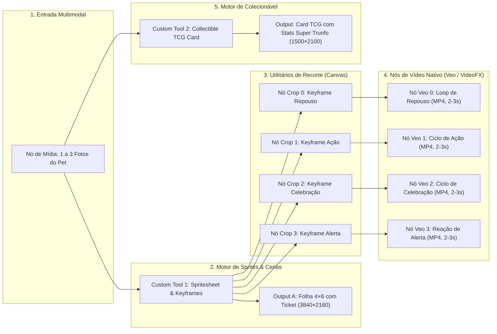

# Guia Operacional de Pipeline: Canvas do Google Flow

> **Objetivo:** Orquestrar o fluxo completo de geração no canvas do Google Flow, desde o upload das fotos até a emissão da folha de sprites, vídeos de animação em loop e o card colecionável.

---

## 1. Topologia Visual do Canvas (Diagrama de Encadeamento)



---

## 2. Passo a Passo de Execução no Google Flow

### Passo 1: Preparação do Workspace e Instalação das Tools
1. Acesse o **Google Flow** em sua sessão ativa.
2. No menu lateral esquerdo, clique em **Tools** ➔ **Create Tool**.
3. Crie a **Custom Tool 1**:
   - Nome: `Pet-a-Pixel: Spritesheet & Keyframes`
   - Adicione as variáveis conforme a tabela de especificação (`01_custom-tool-spritesheet.md`).
   - Cole o prompt mestre e clique em **Save**.
4. Crie a **Custom Tool 2**:
   - Nome: `Pet-a-Pixel: Collectible TCG Card`
   - Adicione as variáveis conforme a tabela de especificação (`02_custom-tool-card-tcg.md`).
   - Cole o prompt mestre e clique em **Save**.

### Passo 2: Ingestão de Referências Fotográficas
1. No canvas em branco, adicione um nó de **Media / Upload**.
2. Faça o upload de 1 a 3 fotos claras do animal de estimação (fotos com boa iluminação: rosto frontal, corpo inteiro de perfil e pose espontânea).
3. Renomeie o nó no canvas para `Fotos_Referencia`.

### Passo 3: Geração da Spritesheet e Cenas-Chave (Tool 1)
1. Arraste a `Pet-a-Pixel: Spritesheet & Keyframes` para o canvas.
2. Conecte a saída do nó `Fotos_Referencia` à entrada visual da Tool 1.
3. Preencha os parâmetros:
   - `{pet_name}`: Nome do pet.
   - `{species_group}`: Escolha o grupo (Canino, Felino, Pequeno Mamífero, Aviário, Réptil).
   - `{distinctive_marks}`: Detalhes físicos chave (ex: "pelagem caramelo, peito branco, orelhas caídas").
   - `{temperament}`: Escolha o humor predominante.
   - `{lighting_mood}`: Escolha o estilo de luz (recomendado: `Studio Neutral 16-Bit`).
4. Clique em **Run / Generate**.
5. O resultado será a imagem ultra-alta (3840×2160 px, 16:9) contendo o ticket à esquerda (15%), a grade 4×6 no centro (60%) e os 4 keyframes empilhados na margem direita (25%) sobre fundo `#26303D`.

### Passo 4: Recorte de Cenas e Encadeamento no Veo (Image-to-Video)
1. **Adicionar 4 nós de utilitário `Crop / Region Select`:**
   - Conecte a saída de imagem da Tool 1 à entrada de cada um dos 4 nós de Crop.
   - Ajuste as caixas de recorte sobre cada uma das 4 cenas-chave localizadas na margem direita da imagem:
     * `Crop_0`: Keyframe de Repouso (topo).
     * `Crop_1`: Keyframe de Ação.
     * `Crop_2`: Keyframe de Celebração.
     * `Crop_3`: Keyframe de Alerta (base).
2. **Conectar aos nós de vídeo Veo:**
   - Adicione 4 nós nativos de **Video Generation (Veo / VideoFX)** ao canvas.
   - Conecte a saída de cada nó de Crop como `First Frame / Image Prompt` do seu respectivo nó de vídeo.
   - Configure a duração para **2 a 3 segundos** (loop curto econômico e estável).
3. **Instruções de Movimento (Motion Prompts Calibrados):**

#### Nó Veo 0 (Loop de Repouso):
```text
Pixel art continuous animation loop, 2 seconds duration. The pixelated character performs a very subtle, gentle rhythmic breathing cycle in place. Strictly static camera, zero camera movement, character coordinates strictly locked in center screen. Strict anatomical consistency, maintain exact 4 limbs, zero shape-shifting, sharp 16-bit contours, zero motion blur, solid background color #26303D.
```

#### Nó Veo 1 (Ciclo de Ação / Corrida):
```text
Pixel art dynamic locomotion animation loop, 2 seconds duration. The pixelated character performs a focused running and forward leaping cycle in place (treadmill style motion). Camera stays strictly stationary, zero pan, zero zoom. Strict anatomical consistency, rigid limb geometry, crisp pixel edges, zero motion blur, solid dark background #26303D.
```

#### Nó Veo 2 (Ciclo de Celebração):
```text
Pixel art joyous celebration animation loop, 3 seconds duration. The pixelated character wags tail and jumps with raised front limbs in happy energetic rhythm, returning to center. Camera completely locked, pure 16-bit stepped frame cadence, sharp contours, zero shape deformation, solid background #26303D.
```

#### Nó Veo 3 (Reação de Alerta):
```text
Pixel art warning and alert reaction animation, 2 seconds duration. The pixelated character lowers head, pins ears back in cautious defensive vigilance, eyes scanning alertly. Zero camera translation, pixel-perfect rendering, rigid anatomical contours, solid #26303D background.
```

4. Execute os nós de vídeo em paralelo. O Flow entregará os 4 clipes de vídeo em MP4 prontos para download e reprodução contínua.

### Passo 5: Geração do Card Colecionável (Tool 2)
1. Arraste a `Pet-a-Pixel: Collectible TCG Card` para o canvas.
2. Conecte o nó `Fotos_Referencia` à entrada da Tool 2.
3. Preencha os atributos:
   - `{pet_name}`: Nome do pet.
   - `{element_affinity}`: Elemento de afinidade (Natureza, Fogo, Vento, Sombra, Luz).
   - `{card_rarity}`: Nível de raridade visual desejado (Lendário, Épico, Raro, Comum).
   - `{signature_ability}`: Nome da habilidade especial divertida.
   - `{stat_profile}`: Preset numérico de Super Trunfo (soma de 350 pts).
   - `{flavor_text}`: Frase curta afetiva sobre as manias do pet.
4. Clique em **Run / Generate**.
5. O resultado será a carta em proporção 2.5:3.5 com a ilustração heroica do pet, moldura detalhada e caixas de atributos numéricos de alto contraste.

---

## 3. Checklist de Encerramento e Validação da Sessão

- [x] Resolução da Tool 1 ajustada para 3840×2160 com cotas proporcionais (15% Ticket, 60% Grade, 25% Keyframes).
- [x] Nós de Crop intermediários devidamente posicionados sobre os keyframes.
- [x] 4 loops de vídeo gerados no Veo com câmera travada e restrição rígida de integridade anatômica.
- [x] Card colecionável emitido com hierarquia tipográfica legível e contraste 10:1 nas caixas de stats.
- [x] Arquivos exportados diretamente do Canvas do Google Flow.
